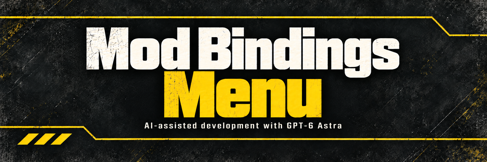

# Mod Bindings Menu v2.3

Adds a native **MODS** tab next to General, Combat and Communication on both the Mouse & Keyboard and Controller binding pages. Every mod binding lives there, grouped under one section header per mod. Rows use Helldivers 2's own capture widgets, activation types (Press, Hold, Double Tap, Long Press and so on) and saved input settings, and bindings work on keyboard, mouse and controller. All installed mods share **36** native bindings (29 assigned automatically, 7 fixed slots). Bindings beyond those have no fixed limit: they appear on a fifth tab, **MORE MODS**, shown only when mods register more bindings than the MODS tab holds, and only outside missions. Two mods may use the same key.

[Ship Station Hotkeys](https://github.com/CowboyBingus/ShipStationHotkeys/releases/latest) (formerly Galactic Menu Hotkey) registers its six shortcuts here, defaulting to Tab, F1 and F5–F8.

Install [the release ZIP](https://github.com/CowboyBingus/ModBindingsMenu/releases/latest) and [Bingus Shared Loader v18 or newer (v19 is current)](https://github.com/CowboyBingus/BingusSharedLoader/releases/latest), plus the mods that use it. Vanilla Plus Megapack also contains Mod Bindings Menu as an option; use either the Megapack option or this package, not both. Enable and deploy, then restart the game. Keep the shared loader as the winning Wwise startup replacement. Mod Bindings Menu replaces no game file: it ships only its own Lua resource.

Updating preserves existing custom bindings. If mission selection still immediately deselects with Ship Station Hotkeys after updating from v2.2 or older, open the **MODS** tab on the affected device's binding page (**Mouse & Keyboard** or **Controller**) and choose **Revert**. This restores clean defaults and also resets custom bindings on that tab for that device; set any custom bindings again afterward.

Translatable: the MODS tab follows the game's Text Language, and so do the bindings of mods that pass their texts as functions (see below). [How to translate](TRANSLATING.md).

## How it works

The tab bar, section headers and rows are drawn by the game. Mod bindings are backed by 36 native input actions from developer-only groups (Freeflight, CinematicCamera, DebugAvatar and Debugmenu) that retail play never reads. Because they are real game actions, the game evaluates each binding's activation type on every device and saves your keys in its own input settings. The developer default mappings those actions shipped with (mouse, controller and some keys) are removed once per action, when a mod binding first uses it. They are also removed from the native reset defaults, so Revert restores only the mod's intended defaults. Custom keys you choose are preserved, even one that equals a developer default; an explicit Revert resets them for the selected tab and device. Original developer defaults are retained privately so a reload of the input configuration or an older saved settings file can still be cleaned. Actions that no mod binding uses in a session are left alone, so another mod that uses those developer actions keeps its keys.

The fixed slots' keyboard defaults (slot 1 Tab, slots 3-7 F1, F5, F6, F7 and F8) are added while the game runs, and only after the build check passes: when native input is ready, each of the six actions gets its key in place of the game's own developer keyboard mapping, in the live bindings and in the reset defaults, wherever the game's stock list is still there. Lists your saved input settings set are left alone. When the game parses its input configuration again (a controller plugged in or out, a settings reset), the stock list comes back; the next sweep (at most 2 seconds, at once when a mod reads the binding) adds the key again. Earlier releases instead shipped a replacement `content/input.config` with these keys, which the game loaded even on builds the mod does not support. Cost: once per session 22 reads (about 1-2 µs each in game) and up to 12 record writes, which are plain data and need no `VirtualQuery`; on later frames no read at all (the sweep compares the records it already reads and writes one only after a re-parse). Idle frames are unchanged. The comparison's CPU time is unmeasured in game.

Ordinary gameplay idle checks and binding polling are unchanged from v2.2. The reset fix adds checks each frame while a binding page is open and during the periodic binding sweep. Its added cost has not been measured in game.

The game cannot hold more than these 36 actions: its input evaluator, its binding maps and its saved settings are fixed in size and name. Bindings beyond them are **extended bindings**, which Mod Bindings Menu evaluates itself from the engine's keyboard, mouse and controller input (never by polling Windows), only when a mod asks for them. Their keys are saved in `ModBindingsMenu.bindings` beside the assignments file, with a backup. A binding keeps its kind for good: a native binding never becomes extended and an extended one never becomes native, so its keys stay where they were saved. The MORE MODS tab lists every extended binding under its mod's header; it is drawn by Mod Bindings Menu inside the game's own list area, since the game's list cannot hold more rows. Choose a row with the mouse, the arrow keys or the D-pad and press Enter, A or click to set its key: Escape or B cancels, Delete, Backspace or X clears it. The keyboard page sets keyboard keys and mouse buttons, the controller page controller buttons; a binding can have both. MORE MODS is offered only outside missions, because text drawn this way with the game's font has crashed missions: in a mission the binding pages show the native tabs and MODS, and extended bindings keep working. Whether a mission runs is read from the game's mission-mode record when a binding page opens and every 60 frames while it is open.

Every frame, the menu's update runs through Bingus Shared Runtime's update guard (`src/bingus_runtime.lua`, an unchanged copy). Its own errors count in bursts, and the 8th of a burst stops it for the session. When the update of a mod below it fails, the menu pauses instead and resumes after 60 frames without such an error: a binding page that was open counts as visited, borrowed texts go back unless a page is open, and your saved keys are never touched. 8 such errors in a burst stop it too. The game's module files are hashed once per session for every mod together (`src/bingus_memory.lua`).

Section headers and text labels borrow unused localization cache entries only while the bindings page is open. Automatically assigned actions are remembered per binding in `%LOCALAPPDATA%\CowboyBingus\Helldivers2\Logs\ModBindingsMenu.assignments`, so keys stay with the right binding across sessions and load orders. The file also records which actions' developer defaults were removed. The previous save is kept beside it as `ModBindingsMenu.assignments.bak`, which is read when the file is missing or damaged. The native offsets and keyboard defaults are for Steam build **25480438** only; the addon checks the executable and DLL hashes before touching the game. On another build it changes nothing: no keyboard default is added and the binding pages stay as the game draws them, and `ModBindingsMenu.log` says to update it. Keys the game saved in its own input settings stay there. It conflicts with other mods that use the same developer input actions.

## For mod authors

Make Mod Bindings Menu and Bingus Shared Loader requirements of your own separately packaged addon. Register bindings and read them each frame:

```lua
-- HD2-Addon: mods/example/your_mod
local BINDING_ID = 'example.your_mod.toggle_hud'
local menu_seen, registered, refusal, was_down = nil, false, nil, false
local hud_visible = true

local function step()
    -- The two addons may load in either order: wait for the menu's table.
    local menu = rawget(_G, 'ModBindingsMenu')
    if not menu or menu.api ~= 1 then return end
    if menu ~= menu_seen then
        menu_seen = menu
        -- Version 2: no slot (nil) assigns a native action automatically.
        local reason
        registered, reason = menu.register_binding(BINDING_ID, 'Toggle HUD', nil,
                                                   {category = 'Your Mod'})
        -- A refusal lasts the session: keep the reason for your log, once.
        if not registered then refusal = reason end
    end
    if not registered then return end -- Use your own default key here.

    local down = menu.is_down(BINDING_ID)
    if down == nil then return end -- No native input: see below.
    if down and not was_down then
        hud_visible = not hud_visible
        -- Apply hud_visible to your mod's UI here.
    end
    was_down = down
end

local previous_update = rawget(_G, 'update')
update = function(dt)
    step()
    if type(previous_update) == 'function' then return previous_update(dt) end
end
```

- `register_binding(id, label, slot, options)` returns `true`, or `false` and a reason. `id` is a stable unique string; it keys the user's saved binding, so never change it. `label` is row text (a string) or a game localization ID (a number, shown in the game's own translation). `options.category` names your mod's section header; without it the header is derived from your addon's `mods/<author>/<entry>` name.
- Texts are UTF-8 in any script, limited in characters (label 127, category 64; v2.0 counted bytes) and shown in upper case, which works for accented, Greek and Cyrillic letters too.
- Translated texts (`version` 3, v2.1 and later): `label` and `options.category` may be functions that return the text in the current language. The menu calls them when you register and each time a binding page opens, so your bindings follow the game's Text Language. A function that fails or returns an unusable text keeps the text shown before. With `version` 2, pass strings. Mods that use `bingus_text.lua` pass `function() return tr('key') end`; see [TRANSLATING.md](TRANSLATING.md).
- Native actions are shared and finite: 36 (`capacity`) for every installed mod together. Beyond them a registration gets an extended binding (`version` 4, below) instead of failing.
  - Slots `1`–`7` are fixed: 1 and 3–7 belong to Ship Station Hotkeys, 2 is the v1 third-party slot. Slot 2 belongs to one `id` across sessions, whatever order the mods load in (v2.3): any other v1.1 addon asking for it is assigned automatically instead of failing, and keeps that action. Slot 2's owner ends like a reservation (below).
  - The other 29 are assigned automatically to bindings registered with `slot` `nil` or `0`.
- Reservations. An automatic action stays reserved for your `id` across sessions, whatever order the mods load in. A mod that registers late, or is left out for a few sessions, keeps its action and its keys.
  - A reservation ends only when its `id` has not registered for 30 sessions that count. A session counts once any mod asks for an automatic binding in it (accepted or refused) and Mod Bindings Menu works on that game build; launches without such mods, test runs included, never age a reservation. A new binding may then get the action, and the old keys are cleared.
  - A new `id` only gets an action no binding holds.
- Reasons for `false` (none changes later in the same session; the menu logs each refused `id` once):
  - `invalid binding registration`: the id, label or slot is not usable.
  - `invalid binding category`: `options.category` is not a usable text.
  - `binding already registered differently`: the `id` registered earlier this session with another slot or label.
  - `slot already in use`: another binding holds that fixed slot (1 or 3–7).
  - `no free binding action; the others are reserved by mods not loaded this session`: no action is free, and some are reserved for mods that have not registered this session. They become free once those reservations end. With `version` 4 only with `options.backend = 'native'`; otherwise the binding is extended.
  - `all 29 automatic binding actions in use`: every automatic action is used by a binding registered this session. With `version` 4 only with `options.backend = 'native'`.
  - `invalid binding backend`, `invalid binding default` (`version` 4): `options.backend` is not `'native'` or `'extended'` (or `'extended'` with a fixed slot), or `options.default` is not a binding spec (below).
  - After a `false`, keep your own default key and log the reason once; do not call `register_binding` every frame. A mod that retries can wait until `revision` changes.
- `is_down(id)` returns whether the binding's activation is satisfied this frame on any device. For Press, Tap and Double Tap that is a short pulse; for Hold it stays true while held. Detect edges as above and apply any gameplay or focus guards your mod needs.
- `is_down(id)` returns `nil` when the `id` is not registered, while native input is unavailable (still loading: `ready()` is false), and for the whole session when this release does not support the game build (after a game update, until Mod Bindings Menu is updated). Treat `nil` as "no binding": use your own default key, or leave the feature off, and keep calling `is_down`. Ship Station Hotkeys falls back to its fixed keys this way.
- `revision` is a number that grows whenever a binding registers, native input becomes ready, or the bindings' texts change. Compare it with `==`; it is `nil` in v2.1 and older.
- `ready()` reports whether native input is available. `version` is `4` and `capacity` is `36`; `api` stays `1`, so v1.1 and v2.0 addons keep working unchanged.

### More bindings than native actions

From `version` 4 a registration that finds every native action held succeeds with an **extended binding** instead of returning `false`. Nothing changes for your code: `is_down` and `poll` answer extended bindings too, and players set their keys on the MORE MODS tab. Test for the feature with `menu.extended ~= nil` (`nil` in older releases), never with `api`, which stays `1`.

```lua
-- Starts on F9, or LB+Y on a controller; the player can change both.
menu.register_binding('example.your_mod.scan', 'Scan', nil, {
    category = 'Your Mod',
    default = {'f9', {button = 'y', device = 'controller', modifiers = {'left_shoulder'}}},
})
```

- `options.backend`: `'extended'` asks for an extended binding even while native actions are free (not with a fixed slot); `'native'` keeps the `version` 3 behaviour, a refusal when none is free. Without it a binding is native while an action is free, else extended. A binding keeps its kind in later sessions whatever the pool holds then.
- `options.default`: the keys an extended binding starts with until the player changes them, as `set_binding` takes them. A native binding ignores it (its default comes from the game's own configuration).
- A binding spec is a button name, or a list of alternatives, each a button name or `{button = name, device = 'keyboard' | 'mouse' | 'controller', modifiers = {names}, trigger = 'press' | 'release' | 'hold'}`. The device defaults to `'keyboard'` and the trigger to `'press'`. Names are the engine's: keyboard keys like `'f9'`, `'g'`, `'left ctrl'`, `'space'`; mouse `'left'`, `'right'`, `'middle'`, `'extra_1'`, `'extra_2'`, `'wheel_up'`, `'wheel_down'`; controller buttons by their Xbox names: `'a'`, `'b'`, `'x'`, `'y'`, `'left_shoulder'`, `'right_shoulder'`, `'left_trigger'`, `'right_trigger'`, `'d_up'`, `'start'` and so on. Modifiers are keyboard keys for keyboard and mouse buttons and controller buttons for controller buttons. Up to 16 alternatives and 4 modifiers each. `{}` means no keys.
- What extended bindings support is in `menu.extended`: `devices` (`{'keyboard', 'mouse', 'controller'}`), `triggers` (`{'press', 'release', 'hold'}`) and `count`, the number registered this session.
  - `press` is true on the frame the inputs become held, `release` on the frame they stop, `hold` while they are held. Any alternative satisfies a binding. An alternative's modifiers must be held with its button; holding more keys than it names does not stop it.
  - Controller buttons count on any connected controller, and a controller plugged in or removed during play is followed.
  - Tap, Double Tap and the other native activation types are not available for extended bindings.
- `set_binding(id, spec)` sets an extended binding's keys as the player would: `{}` removes every key (the default no longer applies), `nil` restores your default. It returns `true`, or `false` and a reason (`not an extended binding`, `invalid binding`, `unknown button: <name>`, `input not ready`, `the bindings file is from a newer version`). It is for mods with a settings screen of their own; the player's choice on the MORE MODS tab is the same change.
- `binding(id)` lists an extended binding's keys as `{{device, button, modifiers = {...}, trigger}...}` with the engine's names (`{}` without keys), or `nil` for other ids and before engine input exists.
- `binding_info(id)` is `nil` for an `id` that is not registered, else `{backend = 'native', slot}` (`slot` only for fixed slots) or `{backend = 'extended', state = 'default' | 'set' | 'cleared' | 'inactive'}`. `inactive` is a binding saved by a newer Mod Bindings Menu, which this one leaves as it is.
- `nil` and `false`: an extended binding's `is_down` is `false`, never `nil`, before engine input exists, without keys (cleared by the player), while the player is choosing a key on a binding page, and when it is inactive. `nil` still means only "not registered" or "unsupported game build", so a mod that falls back to its own keys on `nil` (as Ship Station Hotkeys does) never overrides a player who cleared a binding. While the player chooses a key every mod binding, native ones included, reads `false`.
- Cost: nothing per frame by itself. A binding is evaluated when a mod asks for it, at most once per frame, and each physical input is read from the engine at most once per frame however many bindings use it. One engine read cost about 0.1 µs in game; nothing is allocated per call.

### Polling several bindings

`poll(ids, out)` answers several bindings in one call, with each one's press and release since your previous poll. It is `nil` in v2.1 and older and `version` stays `3`, so test the field, never the version, and keep `is_down` for older releases:

```lua
local IDS = {'example.your_mod.toggle_hud', 'example.your_mod.zoom'}
local polled = {} -- poll fills polled.down, .pressed, .released and .last
local hud_visible, zoomed = true, false

-- Each frame, once your bindings are registered:
local function read_bindings(menu)
    if type(menu.poll) ~= 'function' or not menu.poll(IDS, polled) then
        return -- v2.1 and older: call is_down for each binding, as above.
    end
    if polled.down[1] == nil then
        -- No binding: use your own default key, as with is_down.
    elseif polled.pressed[1] then
        hud_visible = not hud_visible
    end
    zoomed = polled.down[2] == true
end
```

- `ids` is an array of binding ids. `poll` returns `true` once it has written positions `1` to `#ids` of four arrays in `out`, which it creates there at the first poll. It returns `false` and `invalid poll arguments`, and writes nothing, when `ids` or `out` is not a table or one of those four fields of `out` is something else.
- `out.down[i]` is exactly what `is_down(ids[i])` would return at that point: `true`, `false`, or `nil` in the same cases (not registered, native input unavailable, unsupported game build).
- `out.pressed[i]` is `true` when the binding is down and was not at your previous poll with this table; `out.released[i]` is `true` when it was down then and is not now. `nil` counts as up, so a binding that becomes unavailable while down reports `released`.
- `out.last[i]` is the state the next poll compares with. Edges belong to positions: keep each id at its position. Positions after `#ids` are left as they are.
- Edges are relative to your previous poll, not to the previous frame. A frame you do not poll is not seen: if you stop polling while the game is out of focus, a binding released meanwhile reports `released` at your next poll, and one held throughout reports nothing. Set `out.last[i] = false` before a poll to have a binding that is still down report `pressed` again. Mod Bindings Menu does not track focus; apply the focus rule your feature needs.
- A config reload or an older saved settings file can restore developer defaults. When a binding's mapping count changes outside the binding pages, `poll` runs the cleanup before it answers, as `is_down` does, and that binding reads `false` for this frame. No state of that frame is trusted: that poll reports no `pressed` or `released` for any binding and keeps `last`, so a binding held through it reports neither, and one pressed or released on that frame reports it at the next poll. On a binding page a changed list is the player's choice, and edges are reported as usual.
- Cost: one read per binding (its record header, as `is_down` reads it), then one of the input owner and one of the states of every polled binding at once. Six bindings take 8 reads instead of 18 with `is_down`; a read costs about 1-2 µs in game. Nothing is allocated per call once `out`'s arrays hold every position.

Automatically assigned bindings start unbound, so tell users to set a key on the MODS tab. [tests/live/binding_test.lua](tests/live/binding_test.lua) is a complete example that registers twelve automatic bindings and logs every activation; [tests/live/extended_test.lua](tests/live/extended_test.lua) registers 45 more and four extended bindings with defaults on every device.

## Validation

Clone BingusSharedLoader beside this repository. Game captures are not included in the source repository. Run `python -B tests/test_build.py` (or `python -B scripts/build.py`) on Windows with Helldivers 2 installed to check the package (one Lua resource, no game resource replaced) and build `releases/Mod-Bindings-Menu-v2.3.zip` from the entry that `scripts/entry.py` assembles out of `src/bingus_text.lua`, `locales/`, the other `src/*.lua` files (Bingus Shared Runtime's `bingus_runtime.lua` and `bingus_memory.lua` among them) and `src/mod_bindings_menu.lua`. Before it packages anything, the build runs every Lua test below in LuaJIT and in the game's own `bin/lua51.dll`, and stops when one fails or when a `tests/test_*.lua` file is missing from its list. It takes LuaJIT from `HD2_LUAJIT`, else from `tools/src/LuaJIT/src/luajit.exe` in a folder above this repository, else from PATH; set `HD2_LUA51_DLL` when the game is installed elsewhere.

Every Lua test runs against simulated game memory. To run one by hand: `luajit tests/<test>.lua`, and in the game's LuaJIT `python tests/game_lua.py tests/<test>.lua` (arguments after the file are passed on):
- `test_api.lua`: the registration contract, reservations across sessions and their expiry, the failure reasons, `revision`, and no read or write at all when the build check fails.
- `test_assignments.lua`: the assignments file: saving through a temporary file and a backup, interrupted and failed saves, session counting.
- `test_sweep.lua`: removal of inherited developer defaults, sanitized per-device Revert, preserved custom keys across restarts, and recovery after config reloads or failed reads.
- `test_mods_tab.lua`: the MODS tab, the label pool, native activation, the per-frame call budget (`tests/frame_budget.lua`), `is_down` and `poll` included, and the update through the runtime guard: error bursts, a pause after an error below (with a page open, and the player's change kept), the stop and the game's shutdown.
- `test_poll.lua`: `poll`'s contract and edges (a config reload, a binding page, unavailable bindings, frames not polled), a differential against `is_down` over 20,000 generated frames on two identical simulated games, and no allocation per call, interpreted and compiled.
- `test_ffi_names.lua`, `test_ffi_names_hostile_first.lua`, `test_ffi_names_mbm_first.lua`: other mods' declarations of the Windows functions this mod and the runtime call, in each load order; the hostile one through `tests/hostile_vm.lua`'s `H.clash` (an unchanged copy of Bingus Shared Runtime's).
- `test_bingus_text.lua`: the translation module; it takes the folder that holds `bingus_text.lua`: `luajit tests/test_bingus_text.lua src` or `python tests/game_lua.py tests/test_bingus_text.lua src`.
- `test_extended.lua`: extended bindings against a simulated engine: registrations beyond 36 (a thousand of them), the options, triggers, alternatives, modifiers, controllers on any connected pad, no press from a key held through a change, `set_binding`, `binding`, `binding_info`, `poll`, one engine read per input per frame, no allocation (interpreted and compiled) and the backend kept across sessions.
- `test_extended_store.lua`: the bindings file: saving through a temporary file and a backup, damaged and missing files, a newer format left untouched, unknown lines kept, failed saves retried.
- `test_capture.lua`: choosing a key: the opening input never captured, Escape cancels, Delete clears, chords, mouse buttons, the controller page, focus loss, the timeout, the page's Back guard restored on every exit, and no phantom press afterwards.
- `test_keyboard_defaults.lua`: the fixed slots' keyboard defaults against the game's real stock and replacement lists: the added lists equal the replacement's byte for byte, saved lists are kept, a re-parse of either map is undone by the next sweep with no extra read, nothing happens on an unsupported build or beside an old replacement, saved custom keys survive an upgrade from and a downgrade to v2.3 (a model of the game's own input settings save), the pinned reads, and no allocation on sweep frames.
- `test_panel.lua`: the MORE MODS tab against simulated game memory and a simulated Gui: the fifth tab, its geometry from the game's widgets, visible rows only, redraws only on a change, navigation, hover, clicks, the wheel, the page's input consumed during a capture, teardown, the per-frame call budget, no allocation on idle frames, and the tab offered only outside missions (no Gui call in one).

Live checks for the binding reset fix have not yet run:
- A Revert: on the MODS tab of each device's binding page, revert the bindings to their defaults. No developer default (mouse, controller) may fire a mod binding; Mod Bindings Menu's own defaults (Tab, F1, F5–F8) stay. Revert also resets custom bindings on the selected tab for that device.
- A controller hot-plug: plug a controller in and out while playing, which reloads the input configuration, and wait 2 seconds. No developer default may fire a mod binding, and the keys you chose stay.

Extended bindings and the MORE MODS tab are verified offline only. Checked in game so far: the engine input functions they use exist and a key read costs about 0.1 µs. Still to check in game: presses, the tab's drawing and position at several resolutions, choosing, clearing and cancelling keys on both pages (Escape and B must not close the page), keys kept after a restart, controller hot-plug, and a language other than English.

Live tests confirmed the MODS tab on both binding pages, per-mod section headers, twelve automatic bindings, Double Tap, duplicate keys and bindings persisting across restarts. Controller button activation and the removal of the inherited mouse and controller mappings are verified offline only, as are the changes since v2.1 (reservations, the removal of developer defaults once per action, the assignments file's backup).

[Artwork and generation prompts](assets/ARTWORK.md): made with the built-in ImageGen tool.

**AI disclosure:** AI-assisted development with GPT-6 Astra and Claude Opus 5.5. Claude Opus 5.5 assisted with research, implementation, tests and documentation, not the artwork.

## License

Zero-Clause BSD (0BSD): use, copy, modify and distribute for any purpose, with no conditions. See `LICENSE`.
